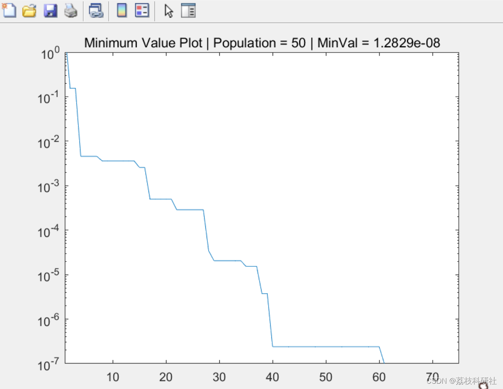
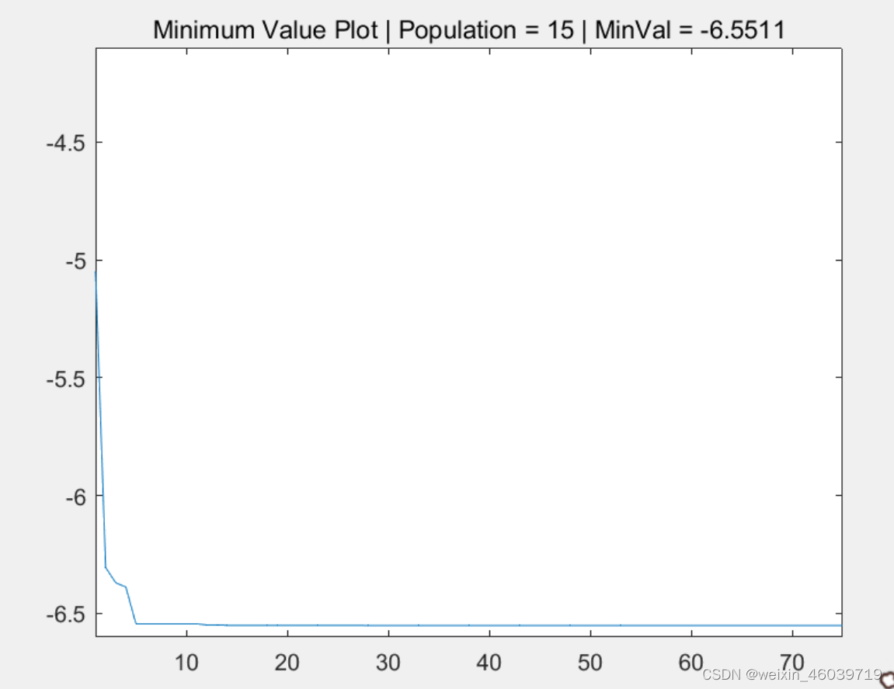
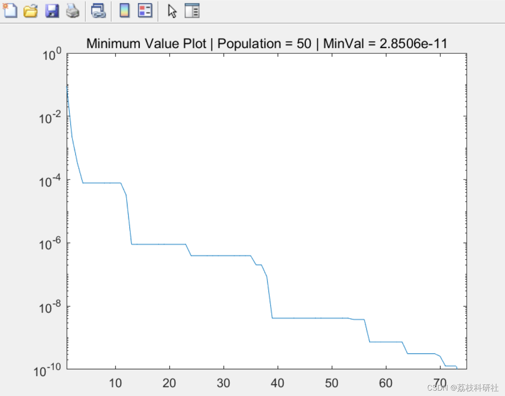
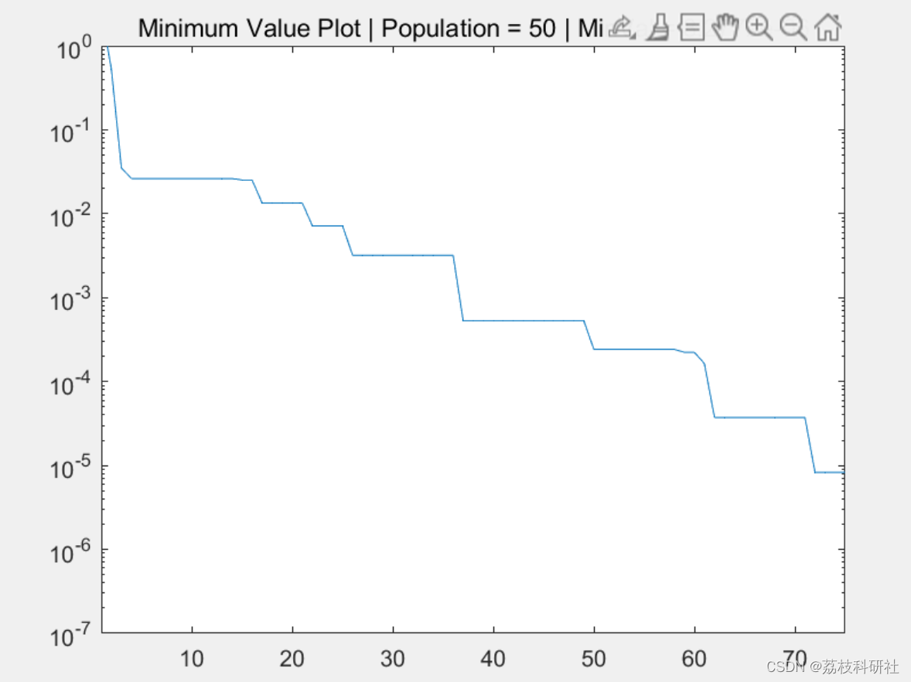

# Integration of Multi-Strategy Firefly Algorithm for Solving Multi-Objective Optimization Problems (Matlab Code Implementation)

​  
📚2 Running Results Editing
Editor
Edit the code section:
clear;  
clf;  
problem = @(x) problemfunc(x);  
nvar = 2;  
bound.xmin = -5;  
bound.xmax = 5;  
param.itermax = 75;  
param.npop = 50;  
param.gamma = 1;  
param.beta0 = 1;  
param.alpha = 0.2;  
param.damp = 0.9;  
param.scale = (bound.xmax-bound.xmin);  
FA(problem, nvar, bound, param)  
% [X,Y] = meshgrid(bound.xmin:0.01:bound.xmax, bound.xmin:0.01:bound.xmax);  
% surf(X,Y,-20*exp(-0.2*sqrt(0.5*(X.^2+Y.^2)))-exp(0.5*(cos(2*pi*X)+cos(2*pi*Y)))+exp(1)+20, 'EdgeColor','none');  
% view(-33,72); saveas(gcf, 'Ackley2.png');  
clear;  
clf;  
problem = @(x) problemfunc(x);  
nvar = 2;  
bound.xmin = -5;  
bound.xmax = 5;  
param.itermax = 75;  
param.npop = 50;  
param.gamma = 1;  
param.beta0 = 1;  
param.alpha = 0.2;  
param.damp = 0.9;  
param.scale = (bound.xmax-bound.xmin);  
FA(problem, nvar, bound, param)  
% [X,Y] = meshgrid(bound.xmin:0.01:bound.xmax, bound.xmin:0.01:bound.xmax);  
% surf(X,Y,-20*exp(-0.2*sqrt(0.5*(X.^2+Y.^2)))-exp(0.5*(cos(2*pi*X)+cos(2*pi*Y)))+exp(1)+20, 'EdgeColor','none');  
% view(-33,72); saveas(gcf, 'Ackley2.png');  
🌈3 Matlab code implementation
🎉4 References
​  

## Images

<!-- PAYMENT_BLOCK -->

## Get this dataset

- Payment link (Stripe): [Buy now](https://buy.stripe.com/3cs8yP7sY87d0vu9AB)
- Payment QR code: 

<!-- /PAYMENT_BLOCK -->
